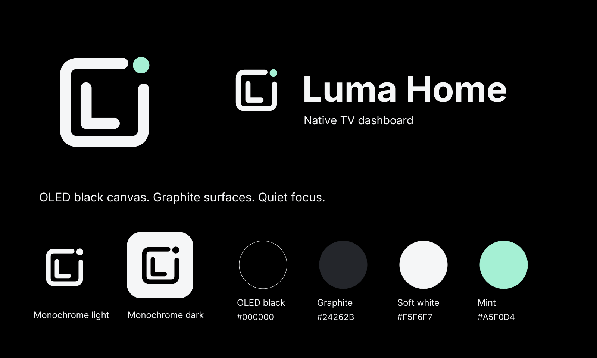

# Luma Home identity

The identity uses an open rounded frame around an L, with a small mint light.
The main canvas is true OLED black (`#000000`); graphite (`#24262B`) is reserved
for tiles and controls. Soft white (`#F5F6F7`) supplies legible ink, with mint
(`#A5F0D4`) used sparingly. UI components continue to use shared theme roles.

The [imagegen reference](imagegen-reference.png) was made with the built-in
image generation tool, then refined for the OLED requirement. The [prompt set](generation-prompts.json)
preserves both steps. The SVGs are a manual geometric recreation with flat fills;
they contain paths and shapes, with no embedded raster image. The wordmarks are
outlined from the repository's OFL Inter fonts, so consumers need no installed font.
The fonts and their notices remain in `pkg/` and `licenses/`.

| Asset | Use |
| --- | --- |
| [icon.svg](icon.svg) | Rounded app icon on true black |
| [mark.svg](mark.svg) | Transparent primary mark |
| [mark-mono-light.svg](mark-mono-light.svg), [mark-mono-dark.svg](mark-mono-dark.svg) | One-colour use at small sizes |
| [wordmark-dark.svg](wordmark-dark.svg), [wordmark-light.svg](wordmark-light.svg) | Transparent outlined lockups |
| [banner.svg](banner.svg) | Repository/header artwork |
| [brand-board.svg](brand-board.svg) | Editable identity and palette overview |
| `icon-{32,64,128,160,512}.png` | Raster app/avatar exports |

Regenerate with `python3 generate.py` from an environment containing
`fonttools==4.67.0` and `rsvg-convert`. The script resolves the repository fonts
relative to itself. Generated SVGs were parsed and the raster board/icon exports
were visually reviewed. This identity uses no Apple, Plex or PlxNative brand mark.

Keep broad TV backgrounds black and raised surfaces graphite. Avoid persistent
bright logos, decoration or status text when idle. Black backgrounds do not
eliminate risk from bright static elements; native idle/suspension behaviour and
LG's existing panel protections remain separate requirements.
