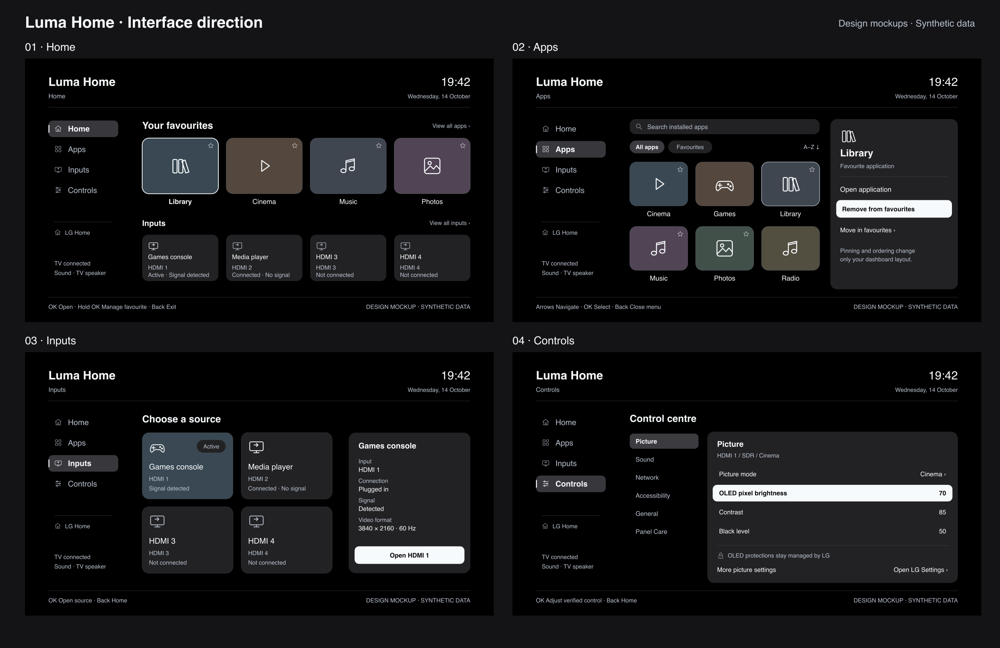

# Luma Home interface concepts

These are **design mockups, not TV captures or implemented capability**. App
names, icons, clock, source states, audio status and setting values are synthetic.
They describe the intended finished interface; the running preview remains more
limited. See the [implementation plan](../implementation-plan.md) and
[current evidence](../../README.md#evidence-boundaries) for that distinction.



| Concept | Intended experience | Open full render |
| --- | --- | --- |
| Home | Favourites and all four HDMI sources on one page, with device status and an explicit return to LG Home. | [Home, 1920 × 1080](home.png) |
| Apps | Installed-app search, all/favourites filter and stable alphabetical grid. A long OK press opens a native menu for pinning and ordering favourites. | [Apps, 1920 × 1080](apps.png) |
| Inputs | Four source cards distinguish an active source, plug connection and signal detection. The detail pane shows format only when reliably available. | [Inputs, 1920 × 1080](inputs.png) |
| Controls | Category/detail navigation, context-bound picture rows and an explicit LG Settings route for wider or protected settings. | [Controls, 1920 × 1080](controls.png) |

## Design decisions

The concepts use an OLED-black canvas with PlxNative's graphite surfaces, cool off-white ink and
rounded shared cards/forms. The 1920 × 1080 logical canvas uses 96 px outer
margins, a persistent four-item rail and Inter's existing 24/26/28/32/40/48 px
type scale. Ordinary text never drops below the 24 px couch-legibility floor.
Synthetic app artwork uses restrained colours and original line icons; those
colours are artwork, rather than new product chrome tokens. Implementation must
compose shared native components and theme roles instead of copying SVG drawing
primitives into screens.

An off-white plate or ring marks the foreground focus. Lower-contrast rail and
category fills mark the current route; a quieter app outline identifies the
item whose context menu is open. Source activity has its own text badge, so it
is not confused with focus. Focus follows app identity when a catalogue changes.
Back dismisses the current menu, returns to its parent, then exits from Home.
LG keeps Home, volume, power and the underlying TV services.

The Apps image shows a menu state. The normal drawer can use the space occupied
by that panel for more grid columns. Search opens a native text-entry surface;
filter, search, ordering and menu detail remain planned work. A hold must never
also launch the application when released. Ordering and pinning affect only
dashboard preferences.

Home supplies immediate source access without browsing to Inputs. Inputs adds
details; a plugged-in cable, a detected signal and an active source are separate
facts. Names and video format must use authoritative readings. Missing format
must say unavailable, rather than inferring it from the chosen source.

Controls illustrates an eventual validated native control state. Its brightness,
contrast and black-level rows **do not establish that writing those settings is
available or safe on webOS 24**. A row becomes editable only after the specific
operation passes capability, current-context and readback validation. Otherwise
it remains view-only, unavailable or opens LG Settings. A changed input, dynamic
range or picture mode invalidates old readings and pending edits. The category
structure covers Picture, Sound, Network, Accessibility, General and Panel Care;
OLED protections, network reconfiguration, firmware, reset and service/calibration
functions stay with LG. The native dashboard is a comprehensive entry point,
with clearly identified LG-managed routes where direct control is inappropriate.

## Relationship to current proof

The native preview already renders cards and forms on the G2 and has tested
catalogue identity, gesture cancellation, favourite save/readback and clean
removal. The normal app has read some catalogue, HDMI and picture endpoints.
Later milestones now prove bounded ordinary-app live refresh and launching an
isolated native test target. They do not establish audio status, verified source
switching, a clock/status rail, search, ordering,
setting writes, physical remote/pointer coverage or dashboard performance.
The render watermark stays visible in every exported concept so these images
cannot be mistaken for that device evidence.

## Editable sources and regeneration

The four `.svg` files and `overview.svg` are editable vector artwork. The
`render.py` source generates them and renders local PNGs through `rsvg-convert`:

```sh
python3 examples/native-home/docs/concepts/render.py
```

It uses the repository's existing OFL Inter fonts through a temporary Fontconfig
file. It has no device connection, external assets or application execution.
The individual PNGs are 1920 × 1080; the overview is 2560 × 1660. SVG and PNG
sources are retained; PNG output was opened and visually reviewed for text fit,
spacing and state clarity.
This is visual design review only, with no runtime or performance claim.
